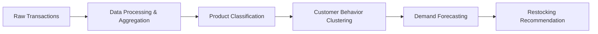

<h1 align="center">Recommended Product Restocking System 👋</h1>

<p align="center">
  
  
  
</p>

> An automated grocery inventory restocking decision system utilizing First-In, First-Out (FIFO) methodology and Machine Learning to minimize spoilage and prevent empty shelves.

## 📖 Project Overview

The **Recommended Product Restocking System** automates grocery restocking decisions to optimize inventory management. By employing a First-In, First-Out (FIFO) methodology, the system ensures that product turnover is efficient, minimizing spoilage and preventing stockouts. 

A core component of the system is the distinction between inventory types:
- **Volatile/Perishable Inventory:** High-risk items with short shelf lives (e.g., fresh produce, dairy).
- **Stable/Long-Life Inventory:** Low-risk, packaged goods with extended shelf lives (e.g., canned goods, dry pasta).

---

## ✨ Key Features

- **FIFO-Based Inventory Management:** Prioritizes older stock to reduce spoilage.
- **Volatile vs. Stable Product Classification:** Automatically routes products into high-risk or low-risk operational tracks.
- **K-Means Behavioral Clustering:** Identifies purchasing patterns such as frequency, recency, and basket affinity.
- **Demand Forecasting:** Predicts future inventory requirements.
- **Linear Regression for Steady Demand:** Accurately forecasts stable, long-life inventory trends.
- **Decision Trees for Volatile/Non-linear Demand:** Captures the complex, shifting demands of perishable goods.
- **Daily & Weekly Demand Aggregation:** Filters out noise to capture actionable trends.
- **Privacy-Conscious Dataset Usage:** Explicitly excludes sensitive demographic data.
- **Desktop Dashboard:** A modern, accessible interface tailored for store managers.

---

## 🤖 Machine Learning Architecture

The system's intelligence is divided into three primary machine learning tiers:

### 1. Classification Tier
Categorizes incoming inventory into **volatile** or **stable** segments. This classification is based on product metadata and shelf-life constraints, ensuring that high-risk items receive the appropriate forecasting priority.

### 2. Behavioral Clustering
Utilizes **K-Means Clustering** to discover underlying customer purchasing patterns. By analyzing shopping frequency, recency, and basket affinity, the system builds an understanding of product demand drivers. Notably, this is achieved *without* collecting invasive demographic profiles; all demographic tables are explicitly excluded.

### 3. Demand Regression
Generates estimated restocking quantities using a dual-model approach:
- **Linear Regression:** Applied to stable items where demand trends are relatively steady and predictable.
- **Decision Trees:** Deployed for volatile items where demand shifts are non-linear and highly variable. 
The final output of this tier is a precise, estimated restocking quantity for each product.

---

## 📊 Data Pipeline

The project utilizes the **Dunnhumby "The Complete Journey"** dataset. The pipeline is designed to transform raw transaction logs into actionable machine learning features while strictly adhering to privacy-conscious design principles.

1. **Dataset Integration:** Transaction logs are joined with product definitions.
2. **Privacy Enforcement:** Demographic tables are entirely excluded.
3. **Temporal Aggregation:** Timestamped purchases are aggregated into daily and weekly intervals.
4. **Noise Reduction:** Data smoothing techniques filter out day-to-day noise to capture true demand trends.
5. **Feature Preparation:** Cleaned and structured data is fed into the ML models.



---

## 🖥️ Desktop Interface

The application features a modern desktop UI built entirely in Python using **CustomTkinter**. Designed specifically from a store-manager perspective, the dashboard provides:

- Real-time monitoring of current inventory levels.
- Clear visualizations of demand predictions and restocking recommendations.
- Quick identification of high-risk, volatile products nearing expiration or stockout.
- Streamlined workflows for daily inventory decision-making.

---

## 🛠️ Technology Stack

| Category | Technology |
| :--- | :--- |
| **Language** | Python |
| **Desktop UI** | CustomTkinter |
| **Clustering** | K-Means |
| **Forecasting (Stable)** | Linear Regression |
| **Forecasting (Volatile)**| Decision Trees |
| **Dataset** | Dunnhumby "The Complete Journey" |

---

## 📈 Operational Impact

Accurate forecasting is especially critical for high-risk inventory. The Recommended Product Restocking System delivers significant operational impact by:

- **Prioritizing Perishables:** High-precision forecasting is focused on perishable items where stockout costs and expiration losses are the highest.
- **Reducing Stockouts:** By accurately predicting demand, the system ensures shelves remain stocked, protecting revenue and customer satisfaction.
- **Minimizing Spoilage Losses:** The combination of FIFO enforcement and precise restocking quantities prevents over-ordering of short-shelf-life goods.

---

## 🔬 Methodology

The system operates as an end-to-end pipeline. Incoming transaction data is first stripped of demographic identifiers and aggregated into daily/weekly timeframes to establish baseline trends. The Classification Tier then splits the products based on volatility. 

Parallel to this, the Behavioral Clustering model analyzes anonymous purchasing habits (recency, frequency, basket affinity) to group similar buying patterns. Finally, the Demand Regression tier takes these grouped trends and the classified product data to generate specific restocking quantities. Linear models handle the predictable staples, while Decision Trees navigate the complex demand of perishables. These recommendations are then surfaced to the store manager via the CustomTkinter dashboard.

---

## 🔐 Privacy Considerations

This project was built with a privacy-by-design approach. The system deliberately excludes all demographic tables from the Dunnhumby dataset. By focusing exclusively on purchasing behavior (such as recency, frequency, and basket affinity) rather than personal identities, the system achieves highly accurate demand forecasting without compromising consumer privacy.

---

## 🔮 Future Improvements

The current architecture provides a modular foundation designed for future enhancements. Planned improvements include the incorporation of:

- **Supplier Lead Times:** Adjusting restocking recommendations based on the delay between ordering and receiving goods to further prevent stockouts.
- **Seasonal Demand Shifts:** Integrating time-series seasonality to anticipate macro-trends (e.g., holiday baking supplies, summer beverages).
- **Promotional Calendars:** Factoring in planned sales and discounts, which temporarily warp standard demand curves.

---

## 🚀 Installation & Usage

### Prerequisites
Ensure you have Python installed on your system. 

### Setup

1. Clone the repository:
   ```bash
   git clone <repository-url>
   cd recomended_product_restocking_system
   ```

2. Create and activate a virtual environment (recommended):
   ```bash
   python -m venv venv
   source venv/bin/activate  # On Windows use `venv\Scripts ctivate`
   ```

3. Install the required dependencies:
   ```bash
   pip install -r <requirements-file>
   ```

4. Run the desktop application:
   ```bash
   python <entry-point>
   ```

---

## 📁 Project Structure 
*(Example Template)*

```text
recomended_product_restocking_system/
│
├── data/                  # Raw and processed Dunnhumby datasets
├── models/                # ML models (K-Means, Linear Regression, Decision Trees)
├── ui/                    # CustomTkinter dashboard components
├── src/                   # Core application logic and data pipelines
├── <requirements-file>    # Project dependencies
├── <entry-point>          # Main application script
└── README.md              # Project documentation
```

---

## 🤝 Contributing

Contributions are welcome! If you have a suggestion that would make this better, please fork the repo and create a pull request. You can also simply open an issue with the tag "enhancement". 

1. Fork the Project
2. Create your Feature Branch (`git checkout -b feature/AmazingFeature`)
3. Commit your Changes (`git commit -m 'Add some AmazingFeature'`)
4. Push to the Branch (`git push origin feature/AmazingFeature`)
5. Open a Pull Request

---

## 📝 License

Distributed under the `<License-Type>` License. See `<license-file>` for more information.

---

## 🙏 Acknowledgements

- **Dunnhumby:** For providing the foundational **The Complete Journey** dataset used to train and test the machine learning architecture.
