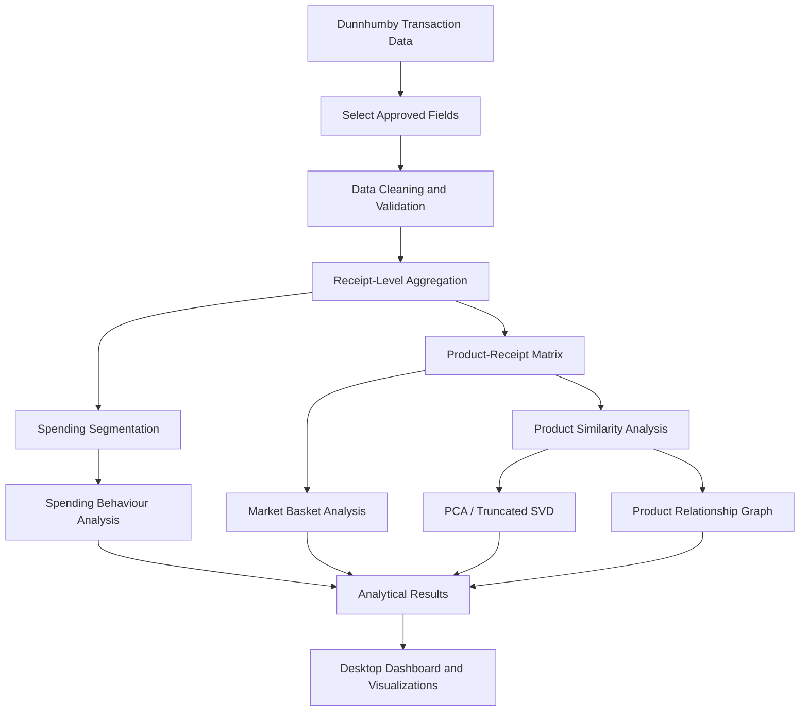

# Recommended Product Restocking System

<p align="center">
  
  
  
  
</p>

> **Alpha 1 — Proof of Concept**
>
> An exploratory retail analytics system that uses anonymous receipt-level transaction data to discover purchasing patterns, product associations, spending behaviour, and hidden relationships between products. This proof of concept establishes the analytical foundation for a future machine learning-assisted inventory forecasting and replenishment platform.

---

## 📌 Table of Contents

- [Overview](#-project-overview)
- [Alpha 1 Scope](#-alpha-1-data-scope)
- [Features](#-key-features)
- [Analytical Methods](#-machine-learning--analytical-methods)
- [Data Pipeline](#-data-pipeline)
- [System Architecture](#-system-architecture)
- [Desktop Interface](#-desktop-interface)
- [Technology Stack](#️-technology-stack)
- [Privacy and Data Constraints](#-privacy-and-data-constraints)
- [Development Roadmap](#-development-roadmap)
- [Installation](#-installation--usage)
- [Project Structure](#-project-structure)
- [Acknowledgements](#-acknowledgements)

---

## 📖 Project Overview

The Recommended Product Restocking System aims to develop an intelligent retail inventory and replenishment platform using transaction analytics, machine learning, and inventory optimization.

**Alpha 1** focuses on exploring purchasing behaviour through the Dunnhumby *The Complete Journey* dataset.

Instead of immediately predicting restocking quantities, this version investigates the relationships between products and receipts to discover patterns that may not be immediately apparent.

### 🎯 Primary Objectives

- Discover products that are frequently purchased together.
- Identify purchasing associations and complementary product relationships.
- Segment receipts according to spending behaviour.
- Identify products with similar purchasing patterns.
- Visualize hidden product relationships using dimensionality reduction.
- Discover unusual receipt compositions and unexpected correlations.
- Establish the analytical foundation for future demand forecasting.

**Long-term goal:** Transform these analytical capabilities into a digital inventory management and predictive replenishment system.

---

## 📊 Alpha 1 — Data Scope

**Dataset:** Dunnhumby — The Complete Journey

Alpha 1 deliberately uses a restricted set of receipt-derived information.

### Approved data fields

| Field | Description | Origin |
|---|---|---|
| `BASKET_ID` | Unique receipt/basket identifier | Transaction data |
| `PRODUCT_ID` | Identifier of the purchased product | Transaction data |
| `ITEM_LINE_VALUE` | Monetary value associated with a purchased product line | `SALES_VALUE` |
| `RECEIPT_TOTAL` | Total monetary value of a receipt | Derived using `BASKET_ID` |

**Data processing rules:**

- `BASKET_ID` groups products belonging to the same receipt.
- `PRODUCT_ID` identifies individual products.
- `ITEM_LINE_VALUE` represents the transaction-line value, not necessarily the unit price.
- `RECEIPT_TOTAL` is calculated by aggregating the included product-line values within each basket.

> **Note:** `RECEIPT_TOTAL` is a derived field, not an independent raw transaction column. The exact customer-paid receipt total may differ from a total calculated using `SALES_VALUE`, depending on the dataset's discount and transaction-value semantics.

### Excluded information

Alpha 1 does not use:

- Customer or household identifiers.
- Customer names or addresses.
- Demographic or psychographic information.
- Transaction dates and timestamps.
- Product purchase quantities.
- Store identifiers.
- Coupon and promotional information.
- External customer profiles.

This restricted scope allows the proof of concept to focus on anonymous receipt-level purchasing relationships.

---

## ✨ Key Features

| Feature | Description |
|---|---|
| **Market Basket Analysis** | Discovers products frequently purchased together. |
| **Association Rule Mining** | Measures the strength of purchasing relationships. |
| **Receipt Spending Segmentation** | Groups receipts by their total spending. |
| **Product Behavioural Similarity** | Identifies products with similar receipt appearances. |
| **Dimensionality Reduction** | Visualizes high-dimensional product relationships. |
| **Product Clustering** | Groups products with similar purchasing patterns. |
| **Product Relationship Networks** | Represents products and their associations as a graph. |
| **Anomaly Detection** | Investigates unusual receipt compositions and product patterns. |

### 1. Market Basket Analysis

Discover relationships between products appearing in the same receipt.

**Algorithms:**
- Apriori
- FP-Growth
- Eclat

**Evaluation metrics:**

| Metric | Purpose |
|---|---|
| Support | Frequency of a product combination. |
| Confidence | Frequency of one product appearing with another, given the first product. |
| Lift | Strength of association relative to independent occurrence. |

**Potential applications:**
- Frequently purchased product combinations.
- Complementary product discovery.
- Bundle recommendation opportunities.
- Unexpected product associations.

### 2. Receipt Spending Segmentation

Group receipts according to their calculated spending totals.

**Approaches:**
- Median-based segmentation.
- Quartile-based segmentation.
- Spending quantiles.
- K-Means clustering.

**Potential insights:**
- Products frequently appearing in low-, medium-, and high-value receipts.
- Differences in purchasing combinations between spending segments.
- Product contribution to receipt totals.
- Average number of unique products per receipt.

### 3. Product Behavioural Similarity

Construct a product-receipt matrix to represent the purchasing behaviour of individual products.

Example:

| Product | Receipt 1 | Receipt 2 | Receipt 3 | Receipt 4 |
|---|---:|---:|---:|---:|
| Product A | 1 | 1 | 0 | 1 |
| Product B | 1 | 1 | 0 | 0 |
| Product C | 0 | 0 | 1 | 1 |
| Product D | 0 | 0 | 1 | 1 |

`1` indicates that the product appears in the receipt.

This representation enables:
- Product co-occurrence analysis.
- Behavioural similarity measurement.
- Product grouping.
- Product relationship matrix generation.

### 4. Dimensionality Reduction and Visualization

Explore high-dimensional purchasing data through lower-dimensional representations.

**Techniques:**
- Principal Component Analysis (PCA).
- Truncated Singular Value Decomposition (SVD).

**Visualization opportunities:**
- 2D and 3D product similarity plots.
- Product cluster distributions.
- Behavioural group visualization.
- Spending-segment comparisons.

**Clustering experiments:**
- K-Means.
- DBSCAN.
- HDBSCAN.
- Agglomerative Clustering.

Dimensionality reduction helps reveal structures in the data, but visual proximity alone does not establish a strong purchasing association.

### 5. Product Relationship Networks

Represent the purchasing ecosystem as a graph.

| Graph Component | Representation |
|---|---|
| Nodes | Individual products |
| Edges | Purchasing associations |
| Edge weights | Association strength |
| Communities | Groups of interconnected products |

**Potential analysis:**
- Highly connected products.
- Product communities.
- Products connecting different purchasing groups.
- Unexpected product relationships.

Potential graph algorithms include Louvain community detection and other graph clustering techniques.

### 6. Unusual Pattern Discovery

Investigate receipt compositions and product relationships that differ from normal purchasing patterns.

**Potential discoveries:**
- Unusual product combinations.
- Rare but strongly associated products.
- Receipts with unusually high calculated totals.
- Products with unusual co-occurrence profiles.
- Differences in purchasing behaviour across spending segments.

**Techniques:**
- Isolation Forest.
- Statistical anomaly detection.
- DBSCAN.
- Association rule analysis.

---

## 🧠 Machine Learning & Analytical Methods

The Alpha 1 proof of concept combines several analytical approaches rather than relying on a single predictive model.

| Approach | Algorithms / Techniques | Purpose |
|---|---|---|
| Association Mining | Apriori, FP-Growth, Eclat | Product relationships |
| Spending Segmentation | K-Means, quantiles | Receipt grouping |
| Dimensionality Reduction | PCA, Truncated SVD | Product visualization |
| Product Clustering | K-Means, DBSCAN, HDBSCAN | Behavioural grouping |
| Graph Analysis | NetworkX, Louvain | Product communities |
| Anomaly Detection | Isolation Forest, statistical methods | Unusual purchasing patterns |

**Important:** Alpha 1 focuses on unsupervised learning, association mining, and exploratory analysis. A supervised demand forecasting model is planned for a later development stage when suitable temporal and quantity-level data can be collected.

---

## ⚙️ Data Pipeline

The pipeline transforms restricted transaction records into analytical outputs.



### Processing stages

1. **Dataset Integration:** Load the Dunnhumby transaction records.
2. **Field Restriction:** Retain only the approved receipt-derived fields.
3. **Data Cleaning:** Handle missing identifiers, invalid monetary values, and duplicate records.
4. **Receipt Aggregation:** Calculate receipt totals using `BASKET_ID`.
5. **Feature Construction:** Generate product-presence matrices and receipt-level features.
6. **Analytical Processing:** Apply association mining, clustering, dimensionality reduction, and anomaly detection.
7. **Visualization:** Present the results through interactive charts and product relationship views.

---

## 🖥️ Desktop Interface

**Framework:** Python CustomTkinter

The desktop application is designed around the needs of retail inventory managers and data analysts.

### Proposed interface components

- Receipt spending analysis dashboard.
- Product association explorer.
- Product relationship network.
- Product similarity visualization.
- PCA / SVD scatter plots.
- Product clustering results.
- Unusual purchasing pattern reports.

The goal is to make analytical discoveries accessible through a practical desktop interface.

---

## 🛠️ Technology Stack

| Category | Technology |
|---|---|
| Programming Language | Python |
| Desktop GUI | CustomTkinter |
| Data Processing | Pandas, NumPy |
| Machine Learning | Scikit-learn |
| Association Rule Mining | MLxtend |
| Dimensionality Reduction | Scikit-learn |
| Clustering | Scikit-learn |
| Graph Analysis | NetworkX |
| Visualization | Matplotlib / Plotly |
| Dataset | Dunnhumby The Complete Journey |

---

## 🔐 Privacy and Data Constraints

Alpha 1 follows a receipt-level, privacy-conscious analytical approach.

- No customer names or personal profiles are required.
- No demographic attributes are used.
- Purchasing patterns are analyzed using receipt and product identifiers.
- Analysis focuses on aggregate purchasing behaviour.

### Known limitations

| Missing Information | Limitation |
|---|---|
| Purchase quantities | Cannot reliably predict units sold. |
| Timestamps | Cannot perform temporal or seasonal demand forecasting. |
| Inventory history | Cannot detect actual stockout events. |
| Batch information | Cannot implement batch-level FIFO. |
| Expiry dates | Cannot calculate expiry risk. |
| Supplier lead times | Cannot calculate lead-time-aware replenishment. |
| Verified product taxonomy | Cannot reliably identify equivalent products or substitutes. |
| Promotion information | Cannot isolate promotional effects. |

> **Scope clarification:** Alpha 1 is a retail analytics proof of concept, not a complete inventory management or automated restocking application.

---

## 🔮 Development Roadmap

The project will progressively evolve from receipt analytics into an intelligent inventory optimization platform.

### Alpha 1 — Receipt Analytics and Pattern Discovery

- [x] Restricted receipt-level data approach.
- [ ] Market Basket Analysis.
- [ ] Receipt spending segmentation.
- [ ] Product behavioural similarity.
- [ ] PCA / Truncated SVD visualization.
- [ ] Product clustering.
- [ ] Product relationship network.
- [ ] Unusual pattern discovery.

### Alpha 2 — Product Intelligence and Data Infrastructure

- [ ] Centralized product catalogue.
- [ ] Product name normalization.
- [ ] Brand and product-type classification.
- [ ] Human-assisted product taxonomy.
- [ ] Semantic product similarity.
- [ ] Product substitution analysis.
- [ ] Database-backed transaction storage.
- [ ] Timestamp recording.

### Beta — Digital Inventory Management

- [ ] Digital inventory ledger.
- [ ] Stock purchase and sales recording.
- [ ] Quantity-level inventory tracking.
- [ ] Batch-level stock management.
- [ ] FIFO inventory management.
- [ ] Expiry and damage tracking.
- [ ] Supplier information and lead-time records.
- [ ] Historical inventory movement analysis.

### Future ML Development — Predictive Intelligence

- [ ] Global demand forecasting.
- [ ] Nonlinear demand modelling.
- [ ] Intermittent demand forecasting.
- [ ] LightGBM and XGBoost experimentation.
- [ ] Demand uncertainty estimation.
- [ ] Stockout risk prediction.
- [ ] Expiry risk prediction.
- [ ] Cross-product demand analysis.
- [ ] Model evaluation and retraining.

### Future Optimization — Intelligent Replenishment

- [ ] Safety stock calculation.
- [ ] Reorder point calculation.
- [ ] Inventory position estimation.
- [ ] Recommended purchase quantities.
- [ ] Lead-time-aware replenishment.
- [ ] Expiry-aware purchasing recommendations.
- [ ] Inventory cost and wastage analysis.
- [ ] What-if inventory simulations.

*Roadmap items represent planned capabilities and are not claims of completed implementation.*

---

## 🚀 Installation & Usage

### Prerequisites

- Python 3.x
- Git
- Required Python dependencies

### 1. Clone the repository

```bash
git clone <repository-url>
cd recomended_product_restocking_system
```

### 2. Create a virtual environment

```bash
python -m venv venv
```

### 3. Activate the environment

```bash
# Linux / macOS
source venv/bin/activate

# Windows
venv\Scripts\activate
```

### 4. Install dependencies

```bash
pip install -r requirements.txt
```

### 5. Run the application

```bash
python main.py
```

---

## 📁 Project Structure

Proposed project organization:

```text
recomended_product_restocking_system/
│
├── data/
│   ├── raw/                  # Original Dunnhumby data
│   └── processed/            # Restricted and cleaned data
│
├── src/
│   ├── preprocessing/        # Data cleaning and aggregation
│   ├── basket_analysis/      # Association rule mining
│   ├── clustering/           # Product and receipt clustering
│   ├── dimensionality/       # PCA and Truncated SVD
│   ├── graph_analysis/       # Product relationship networks
│   └── anomaly_detection/    # Unusual pattern discovery
│
├── models/                   # Experimental model artifacts
├── ui/                       # CustomTkinter components
├── visualizations/           # Analytical plotting components
│
├── requirements.txt
├── main.py
└── README.md
```

---

## 🤝 Contributing

Contributions, suggestions, and improvements are welcome.

1. Fork the repository.
2. Create a feature branch.
3. Commit your changes.
4. Push your branch.
5. Open a Pull Request.

```bash
git checkout -b feature/your-feature
git commit -m "Add your changes"
git push origin feature/your-feature
```

---

## 📜 License

Distributed under the `<License-Type>` License. See `<license-file>` for details.

---

## 🙏 Acknowledgements

**Dunnhumby** — For providing *The Complete Journey*, the foundational retail transaction dataset used for developing and evaluating this proof of concept.

Dataset source: https://www.dunnhumby.com/source-files/

---

<p align="center">
  <b>Project Status: Alpha 1 — Proof of Concept</b>
  <br/>
  <sub>Exploring retail purchasing behaviour and discovering hidden product relationships through data science.</sub>
</p>
